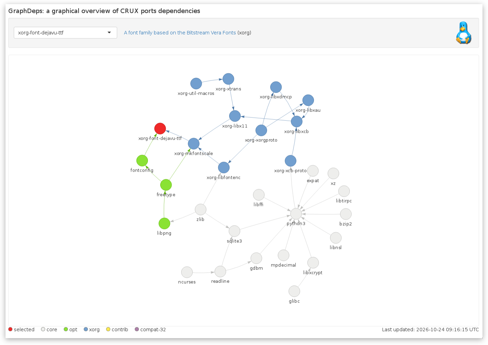

# GraphDeps - a graphical overview of CRUX ports dependencies.

[](https://slackalaxy-graphdeps.share.connect.posit.cloud/)

GraphDeps is a small R Shiny app to graphically show the dependencies between [CRUX](https://crux.nu/) ports. Pick a port from the dropdown menu and it draws
that port's full dependency tree as an interactive network: its direct
dependencies, their dependencies, and so on, all the way down. Nodes can be
dragged around and the view can be zoomed by the mouse wheel. [You can use the app online at Posit](https://slackalaxy-graphdeps.share.connect.posit.cloud/).

## Features
- Repos: `core`, `opt`, `xorg`, `contrib`, `compat-32`
- Arrows point from a dependency to the port that needs it.
- Only the dependencies listed in `# Depends on:` are shown. Optional dependencies (`# Optional:`) are not included.



## Local use
- Installing R dependencies:
```r
install.packages("visNetwork")
install.packages("shiny")
```
- Run manually `download.R`. This will generate the database as CSV (`all.csv`) and a timestamp (`timeUTC.txt`)
- Run GraphDeps from `app.R`

## AI usage
Developed with help from Claude (Anthropic) for code suggestions and debugging.
